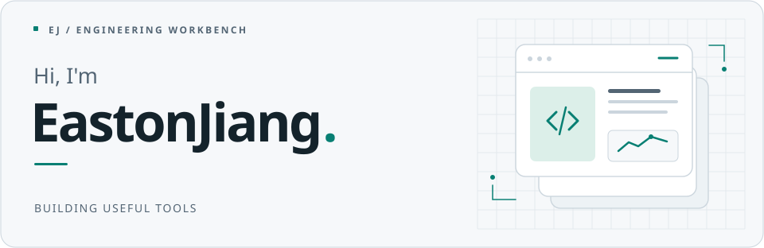

<picture>
  <source media="(prefers-color-scheme: dark)" srcset="./assets/profile-header-dark.svg">
  <source media="(prefers-color-scheme: light)" srcset="./assets/profile-header-light.svg">
  
</picture>

<h2 align="center">前端出发，探索全栈与 AI 应用</h2>

  <em>Building useful tools, one project at a time.</em>

  <a href="https://www.jiangxu.net">个人网站 ↗</a>
  &nbsp; / &nbsp;
  <a href="#selected-projects">精选项目</a>
  &nbsp; / &nbsp;
  <a href="#open-source">开源参与</a>

 

## 01 / About me

- 从前端走向完整应用，继续补齐服务端、数据处理和工程实践。
- 做自己会用的 AI 工具：视频转写、项目学习与面试准备。
- 参与开源项目的问题复现、修复和文档改进，关注 Agent 工具的可靠性。

 

## 02 / Selected projects

### [project-interview-skill ↗](https://github.com/Jaxon1216/interview-analyzer-skill)

**让技术表达回到源码。**

把真实项目整理成源码课程、简历 bullet 和递进面经，连接「理解项目」与「讲清项目」。

`Agent Skills` · `Codex` · `Claude Code` · `Cursor`

---

### [video2text ↗](https://github.com/Jaxon1216/video2text)

**把音视频变成可以继续思考的文字。**

将 B站、抖音和本地音视频转成文字稿，方便交给 AI 继续总结与追问。支持多种转写引擎、任务管理和文字稿历史。

`React` · `FastAPI` · `ASR`

基于 <a href="https://github.com/lanbinleo/bili2text">bili2text</a> 二次开发，感谢原项目。

---

### [GenBI ↗](https://github.com/Jaxon1216/GenBI)

**从一张表格，到一次数据探索。**

React + Go 的 AI 数据分析应用，串起表格上传、异步分析和图表展示。

`React` · `Go / Gin` · `AI 数据分析`

 

## 03 / Open source

### 已合并 · Merged

- **MathModelAgent** · [Prompt 模块化与生成流程改进 #54](https://github.com/jihe520/MathModelAgent/pull/54)
- **MathModelAgent** · [中文绘图、配置校验与进度跟踪修复 #102](https://github.com/jihe520/MathModelAgent/pull/102)
- **ASu-skills** · [新增项目导学入口 #90](https://github.com/Hisn00w/ASu-skills/pull/90)，连接项目理解、源码证据与面试准备。

<strong>近期提交 · Submitted</strong>

 

以下是已提交、尚未合并的改进（核对于 2026-10-16），最新状态以对应 PR 为准。

- **DeerFlow** · [文档转换处理 #6924](https://github.com/bytedance/deer-flow/pull/6924)
- **OpenHands SDK** · [Token 统计说明 #6001](https://github.com/OpenHands/software-agent-sdk/pull/6001)
- **Vercel AI SDK** · [校验模式延迟初始化 #22552](https://github.com/vercel/ai/pull/22552)

 

## 04 / Toolkit

**前端** &nbsp; TypeScript / React / Vue / Next.js  
**应用开发** &nbsp; Python / FastAPI / Go / Gin  
**AI 工具** &nbsp; Agent Skills / 模型接入 / AI 辅助开发

在项目里持续补齐后端、数据处理与工程实践。

 

  <a href="https://www.jiangxu.net">更多项目与记录 · jiangxu.net ↗</a>

